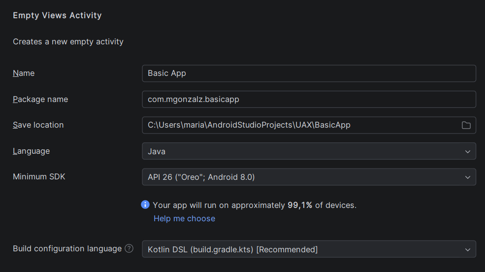
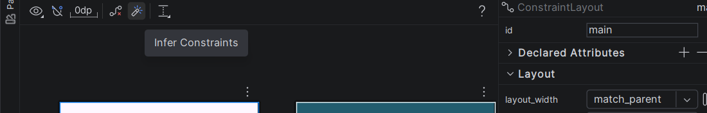
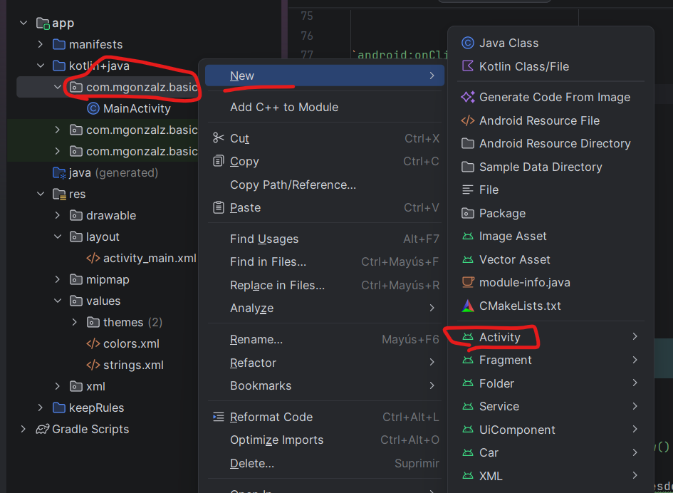
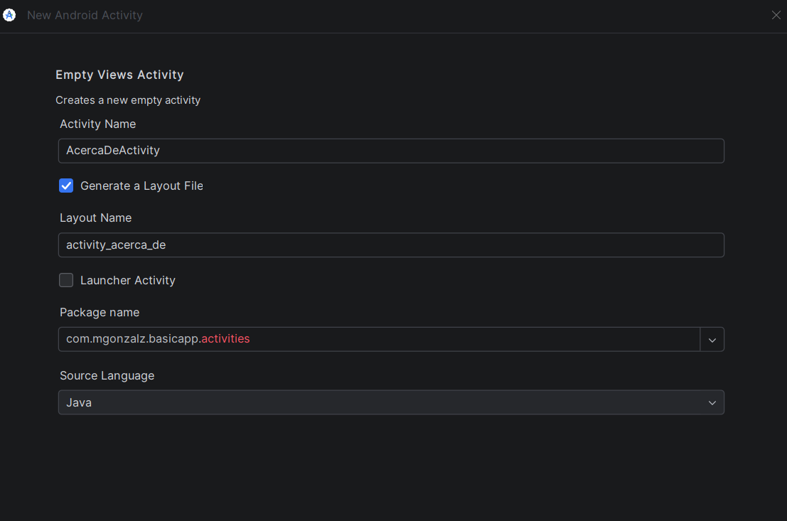

# PDE - Apuntes de Android Studio

## Clase 1. Introducción a Android Studio

### 1. Creación del proyecto

Para crear un proyecto en Android Studio:

1. Seleccionar **Empty Views Activity**.
2. Elegir **Java** como lenguaje.
3. Configurar el nombre del proyecto y el *Package name* (`com.nombre.app`).
4. Configurar el **JDK** compatible con el proyecto si Android Studio lo solicita.



### 2. Estructura del proyecto

Android Studio muestra por defecto la vista **Android**, que agrupa los archivos según su función. Para visualizar la estructura real de carpetas, seleccionamos la vista **Project**.

Android separa principalmente el código de la interfaz gráfica:

- **`MainActivity.java`**: contiene la lógica de la actividad. Una *Activity* representa un componente que normalmente gestiona una pantalla de la aplicación.
- **`activity_main.xml`**: define la interfaz gráfica de esa pantalla, conocida como *layout*.

Al crear un proyecto con *Empty Views Activity*, Android Studio genera ambos archivos automáticamente.

Rutas habituales:

```text
app/src/main/
├── java/com/mgonzalz/basicapp/MainActivity.java
└── res/layout/activity_main.xml
```

Para relacionar la actividad con su layout utilizamos:

```java
setContentView(R.layout.activity_main);
```

### 3. Layouts, vistas y atributos

Un **layout** es un contenedor que organiza los elementos gráficos de una pantalla.

Las **vistas (Views)** son los componentes de la interfaz, por ejemplo:

- `TextView`: muestra texto.
- `Button`: botón interactivo.
- `EditText`: permite introducir texto.
- `ImageView`: muestra imágenes.

Cada vista tiene **atributos** que definen sus propiedades, como el tamaño, el texto o la posición. Se pueden configurar desde el XML, mediante el editor visual o programáticamente desde Java.

#### ConstraintLayout

`ConstraintLayout` permite posicionar componentes mediante restricciones respecto a otros elementos o al contenedor principal (`parent`).

Las restricciones principales son:

| Restricción | Posición |
|---|---|
| `Top` | Arriba |
| `Bottom` | Abajo |
| `Start` | Izquierda (habitualmente) |
| `End` | Derecha (habitualmente) |

Para generar automáticamente las restricciones desde el editor visual podemos utilizar **Infer Constraints**.



### 4. Gestión de eventos

Los eventos permiten ejecutar acciones cuando el usuario interactúa con una vista, por ejemplo, al pulsar un botón.

Existen dos formas de asociar eventos:

**Asociación estática:** se declara directamente en el XML mediante `android:onClick`.

```xml
android:onClick="onBtCambiarTexto"
```

**Asociación dinámica:** se configura desde Java mediante un listener.

```java
btCambiarTexto.setOnClickListener(v -> onBtCambiarTexto(v));
```

En ambos casos podemos utilizar el mismo método:

```java
public void onBtCambiarTexto(View v) {
    Toast.makeText(this, "Pulsaste el botón", Toast.LENGTH_SHORT).show();
}
```

`Toast` muestra un mensaje temporal en pantalla. El `Context` proporciona acceso al entorno de Android y `.show()` muestra el mensaje.

**Diferencia principal:** la asociación estática se declara en el XML, mientras que la dinámica se establece desde Java durante la ejecución, ofreciendo mayor flexibilidad.


Las actividades las podemos entender como pantallas, oncrate es el metood de cliclo de vida, 
los intents son objetos en los qe descrbiimos operaciones y estas oepraciones pueden ser de distitnos tipos, como actividad neuva, un servicio en segundo plano o enviar un broadcast.
para crear una actividad nueva, mejor desde el menu de android, creo ala clase y el layout ascaido file ->new -< activity -< empty views activity y asignar nombre.


cambiamos el paquetes a activitues para organizarlo por paquetes:
