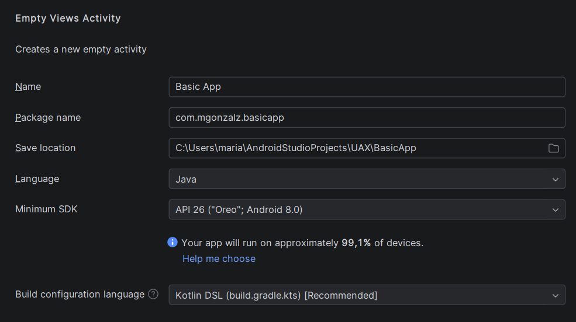
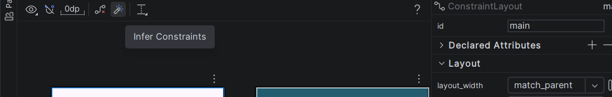
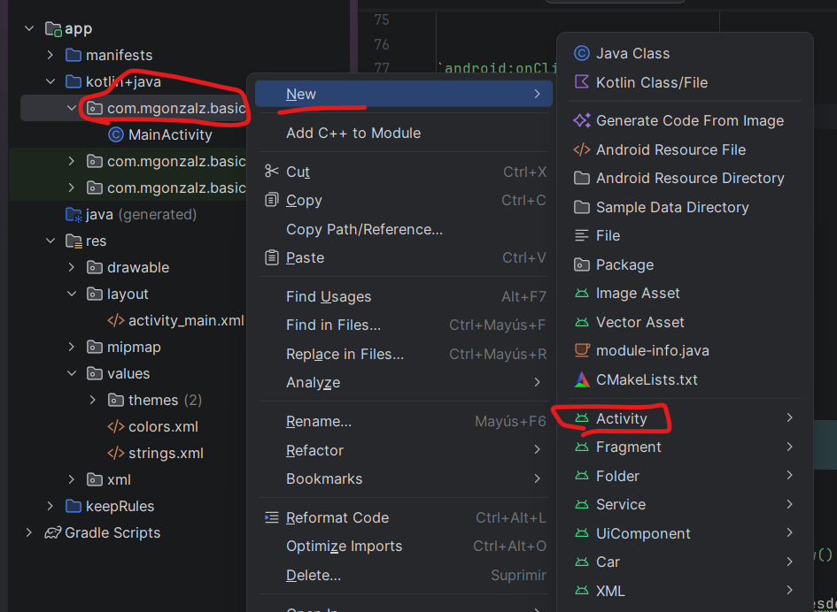
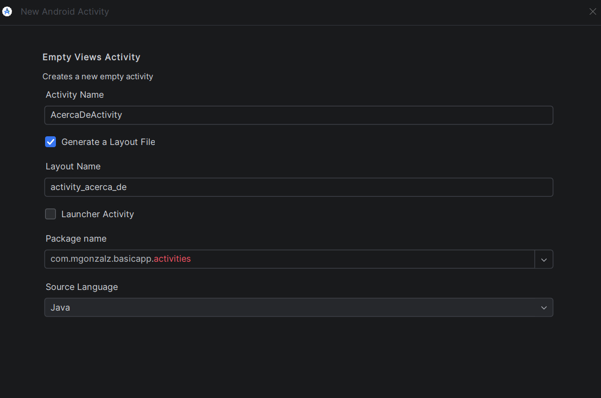
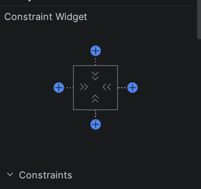

# PDE - Apuntes de Android Studio

## Clase 1. Introducción a Andr

oid Studio

### 1. Creación del proyecto

Para crear un proyecto en Android Studio:

1. Seleccionar **Empty Views Activity**.
2. Elegir **Java** como lenguaje.
3. Configurar el nombre del proyecto y el *Package name* (`com.nombre.app`).
4. Configurar el **JDK** compatible con el proyecto si Android Studio lo solicita.



### 2. Estructura del proyecto

Android Studio muestra por defecto la vista **Android**, que agrupa los archivos según su función. Para visualizar la estructura real de carpetas, seleccionamos la vista **Project**.

Android separa principalmente el código de la interfaz gráfica:

- **`MainActivity.java`**: contiene la lógica de la actividad. Una *Activity* representa un componente que normalmente gestiona una pantalla de la aplicación.
- **`activity_main.xml`**: define la interfaz gráfica de esa pantalla, conocida como *layout*.

Al crear un proyecto con *Empty Views Activity*, Android Studio genera ambos archivos automáticamente.

Rutas habituales:

```text
app/src/main/
├── java/com/mgonzalz/basicapp/MainActivity.java
└── res/layout/activity_main.xml
```

Para relacionar la actividad con su layout utilizamos:

```java
setContentView(R.layout.activity_main);
```

### 3. Layouts, vistas y atributos

Un **layout** es un contenedor que organiza los elementos gráficos de una pantalla.

Las **vistas (Views)** son los componentes de la interfaz, por ejemplo:

- `TextView`: muestra texto.
- `Button`: botón interactivo.
- `EditText`: permite introducir texto.
- `ImageView`: muestra imágenes.

Cada vista tiene **atributos** que definen sus propiedades, como el tamaño, el texto o la posición. Se pueden configurar desde el XML, mediante el editor visual o programáticamente desde Java.

#### ConstraintLayout

`ConstraintLayout` permite posicionar componentes mediante restricciones respecto a otros elementos o al contenedor principal (`parent`).

Las restricciones principales son:

| Restricción | Posición |
|---|---|
| `Top` | Arriba |
| `Bottom` | Abajo |
| `Start` | Izquierda (habitualmente) |
| `End` | Derecha (habitualmente) |

Para generar automáticamente las restricciones desde el editor visual podemos utilizar **Infer Constraints**.



### 4. Gestión de eventos

Los eventos permiten ejecutar acciones cuando el usuario interactúa con una vista, por ejemplo, al pulsar un botón.

Existen dos formas de asociar eventos:

**Asociación estática:** se declara directamente en el XML mediante `android:onClick`.

```xml
android:onClick="onBtCambiarTexto"
```

**Asociación dinámica:** se configura desde Java mediante un listener.

```java
btCambiarTexto.setOnClickListener(v -> onBtCambiarTexto(v));
```

En ambos casos podemos utilizar el mismo método:

```java
public void onBtCambiarTexto(View v) {
    Toast.makeText(this, "Pulsaste el botón", Toast.LENGTH_SHORT).show();
}
```

`Toast` muestra un mensaje temporal en pantalla. El `Context` proporciona acceso al entorno de Android y `.show()` muestra el mensaje.

**Diferencia principal:** la asociación estática se declara en el XML, mientras que la dinámica se establece desde Java durante la ejecución, ofreciendo mayor flexibilidad.


## Clase 2. Actividades e Intents

### 1. Actividades y ciclo de vida

Las **Activities** son componentes de Android que podemos entender como las pantallas de nuestra aplicación.

Cada actividad tiene un **ciclo de vida**, compuesto por distintos métodos que Android ejecuta según su estado.

Uno de los principales es `onCreate()`, que se ejecuta al crear la actividad y permite inicializar sus componentes y configurar la interfaz gráfica.

```java
@Override
protected void onCreate(Bundle savedInstanceState) {
    super.onCreate(savedInstanceState);
    setContentView(R.layout.activity_main);
}
```

### 2. Creación de una nueva Activity

Para crear una actividad desde Android Studio, seleccionamos el paquete correspondiente y seguimos la ruta:

**New → Activity → Empty Views Activity**

Android Studio generará automáticamente la clase Java y su layout XML asociado.



Para organizar mejor el proyecto, podemos crear las actividades dentro de un paquete específico, por ejemplo, `activities`.



### 3. Intents

Los **Intents** son objetos que permiten solicitar operaciones a otros componentes de Android.

Se utilizan, por ejemplo, para:

- Iniciar una nueva actividad.
- Iniciar un servicio.
- Enviar un *broadcast*.

Existen dos tipos principales:

**Intent explícito:** especificamos directamente el componente que queremos iniciar. Por ejemplo, abrir otra pantalla al pulsar un botón.

```java
Intent intent = new Intent(this, SecondActivity.class);
startActivity(intent);
```

**Intent implícito:** indicamos la acción que queremos realizar, pero no especificamos qué aplicación debe ejecutarla. Android busca las aplicaciones compatibles y resuelve cuál utilizar.

Por ejemplo, abrir una página web:

```java
Intent intent = new Intent(
    Intent.ACTION_VIEW,
    Uri.parse("https://www.google.com")
);
startActivity(intent);
```

**Diferencia principal:** en los Intents explícitos indicamos el componente de destino, mientras que en los implícitos indicamos la acción y Android determina qué aplicación puede realizarla.

## Clase 3. ConstraintLayout, Intents y bases de datos SQLite

### 1. Diseño de interfaces: Design y Blueprint

Android Studio ofrece dos modos de visualización para diseñar interfaces gráficas:

- **Design:** muestra el aspecto visual de la interfaz, incluyendo textos, botones, colores y dimensiones.
- **Blueprint:** muestra una representación esquemática de los componentes, sus dimensiones y las restricciones que determinan su posición.

Ambas vistas permiten trabajar con la distribución de los elementos dentro del layout.

### 2. Restricciones en ConstraintLayout

`ConstraintLayout` permite posicionar componentes estableciendo relaciones con otros elementos o con el contenedor principal (`parent`).

Desde el editor visual encontramos distintas herramientas:

- **Autoconnect:** cuando está activado, Android Studio puede generar restricciones automáticamente al colocar elementos. Si lo desactivamos, debemos establecerlas manualmente.
- **Infer Constraints:** genera automáticamente restricciones según la posición actual de los componentes.
- **Clear All Constraints:** elimina todas las restricciones del layout.
- **Clear Constraints of Selection:** elimina únicamente las restricciones de los componentes seleccionados.


Las restricciones también pueden configurarse manualmente. Por ejemplo, si asociamos los extremos superior e inferior de un componente al `parent`, podemos ajustar su posición vertical mediante el *vertical bias*, manteniendo ambas restricciones.

También podemos modificar las restricciones y sus propiedades desde el panel **Attributes → Layout**.



### 3. Navegación mediante Intents

Un `Intent` es un objeto que permite solicitar acciones a otros componentes de Android.

Existen dos tipos principales:

**Intent explícito:** indicamos directamente la actividad que queremos iniciar. Se utiliza habitualmente para navegar entre pantallas de nuestra aplicación.

```java
btSiguiente.setOnClickListener(v -> {
    Intent intent = new Intent(this, SecondActivity.class);
    startActivity(intent);
});
```

- `setOnClickListener()`: detecta la pulsación del botón.
- `new Intent(this, SecondActivity.class)`: crea un Intent indicando la actividad actual como contexto y la clase de la actividad de destino.
- `startActivity(intent)`: inicia la nueva actividad.

**Intent implícito:** indicamos una acción sin especificar directamente el componente que debe ejecutarla. Android busca aplicaciones compatibles y determina cómo resolver la solicitud.

```java
Intent intent = new Intent(
    Intent.ACTION_VIEW,
    Uri.parse("https://www.google.com")
);
startActivity(intent);
```

### 4. Introducción a bases de datos SQLite

Android permite utilizar **SQLite** para almacenar información de forma local en una base de datos relacional.

Para organizar el código relacionado con la base de datos:

1. Hacemos clic derecho sobre el paquete principal del proyecto.
2. Seleccionamos **New → Package**.
3. Creamos un paquete llamado `db`.
4. Dentro del paquete, creamos una clase Java para gestionar la base de datos.

Esta clase puede heredar de `SQLiteOpenHelper`, una clase abstracta de Android que facilita la creación y actualización de bases de datos SQLite.

```java
public class DatabaseHelper extends SQLiteOpenHelper {

    public DatabaseHelper(Context context) {
        super(context, "app.db", null, 1);
    }

    @Override
    public void onCreate(SQLiteDatabase db) {
        // Crear las tablas de la base de datos
    }

    @Override
    public void onUpgrade(SQLiteDatabase db,
                          int oldVersion,
                          int newVersion) {
        // Gestionar los cambios de versión
    }
}
```

Al extender `SQLiteOpenHelper`, Android Studio puede solicitar implementar los métodos abstractos obligatorios mediante **Implement Methods**:

- `onCreate()`: se ejecuta cuando es necesario crear la base de datos por primera vez.
- `onUpgrade()`: se ejecuta cuando se actualiza la versión de una base de datos existente.

**Concepto clave:** `SQLiteOpenHelper` facilita la gestión de la creación y las versiones de una base de datos SQLite local.